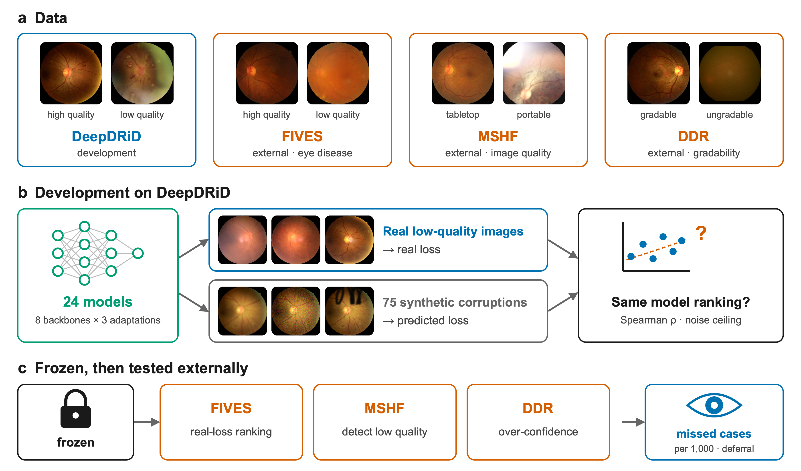
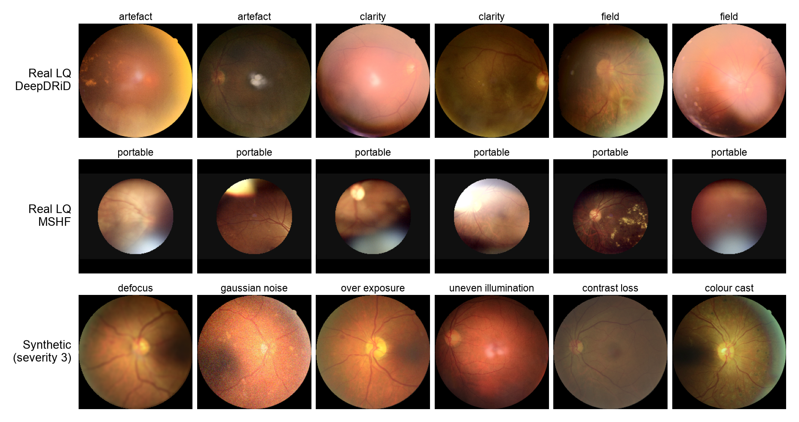
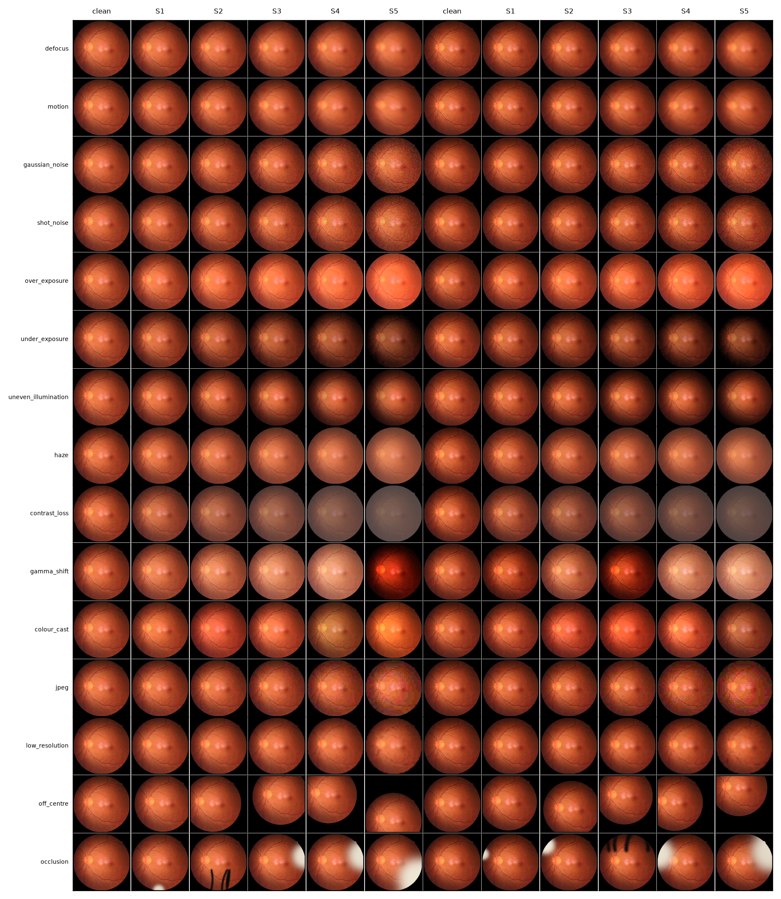
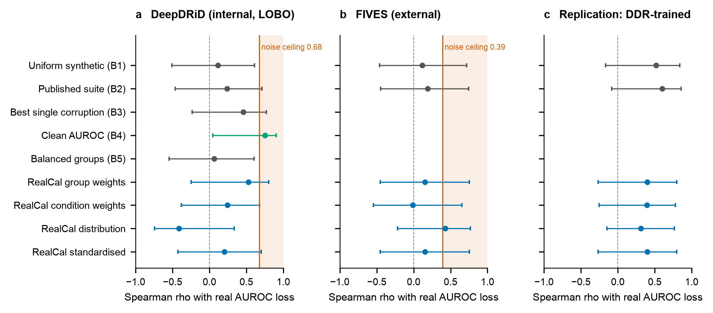

# Synthetic vs real image quality in retinal AI

**Do synthetic corruption benchmarks predict how retinal foundation models fail on real low-quality fundus photographs?**

This repository contains the code and result tables for a multi-dataset evaluation of that question. Twenty-four model configurations (eight backbones, including three retinal foundation models, each adapted in three ways) were trained on high-quality fundus images for referable diabetic retinopathy. Each configuration was then tested on **real** low-quality images and on **75 synthetic corruptions**, and the two rankings of the models were compared.



## Main findings

| Question | Result |
|---|---|
| How much do models lose on real low-quality images? | Median AUROC loss 0.022, or 0.042 after correcting for disease mix (DeepDRiD) |
| Does the synthetic benchmark rank models like real loss? | No. Spearman ρ = 0.11 (95% CI −0.51 to 0.61) |
| Does a synthetic mix calibrated to real loss (RealCal) help? | No significant gain on held-out backbones or on external data |
| Which models lose the most? | The ones with the best clean performance (ρ = 0.75 between clean AUROC and real loss) |
| How reliable is any such ranking? | Noise ceiling ρ ≈ 0.68 (DeepDRiD) and 0.39 (FIVES); several thousand LQ test images are needed for a reliable ranking |
| Are models over-confident on ungradable images? | Yes. About half of ungradable DDR images get a probability above 0.9 |

### Real low-quality images do not look like synthetic corruptions

Real low-quality photographs (top two rows) compared with synthetic corruptions (bottom row):



### The 15 synthetic corruptions (5 severities each = 75 conditions)



### Rank validity of every predictor, with noise ceilings



More figures: [real loss](figures/fig2_real_loss.png) · [clean performance vs loss](figures/fig_clean_vs_loss.png) · [external quality analyses](figures/fig5_external.png)

## Datasets

All four datasets are public. **They are not redistributed here.** Download them from the original sources, follow each dataset's licence and terms of use, and cite the original papers.

| Dataset | Role in this study | Images used | Quality labels | Disease labels | Source | Reference |
|---|---|---|---|---|---|---|
| **DeepDRiD** | Development (training, real loss, RealCal fitting) | 1,989 regular fundus photographs, 499 patients (931 HQ / 1,058 LQ) | Overall quality, artefact, clarity, field definition | DR grade 0–4 | [GitHub: deepdrdoc/DeepDRiD](https://github.com/deepdrdoc/DeepDRiD) | Liu et al., *Patterns* 2022, [doi:10.1016/j.patter.2022.100512](https://doi.org/10.1016/j.patter.2022.100512) |
| **FIVES** | External: real loss on a four-class disease task; primary external endpoint | 800 photographs (592 HQ / 208 LQ; 67 LQ in the official test set) | Illumination/colour, blur, contrast | Normal, AMD, DR, glaucoma | [Figshare 19688169](https://figshare.com/articles/figure/FIVES_A_Fundus_Image_Dataset_for_AI-based_Vessel_Segmentation/19688169) | Jin et al., *Sci Data* 2022, [doi:10.1038/s41597-022-01564-3](https://doi.org/10.1038/s41597-022-01564-3) |
| **MSHF** | External: detecting low-quality images (tabletop vs portable cameras) | 792 tabletop and portable photographs (369 HQ / 423 LQ); ultra-widefield images not used | Illumination, clarity, contrast, overall (3 ophthalmologists) | None used | [Figshare 21507564](https://doi.org/10.6084/m9.figshare.21507564.v1) | Jin et al., *Sci Data* 2023, [doi:10.1038/s41597-023-02188-x](https://doi.org/10.1038/s41597-023-02188-x) |
| **DDR** | External: ungradable-image detection, over-confidence, replication (train on DDR, test on DeepDRiD) | 13,673 DR-grading photographs (12,522 gradable / 1,151 ungradable) | Gradable vs ungradable | DR grade 0–4 | [GitHub: nkicsl/DDR-dataset](https://github.com/nkicsl/DDR-dataset) | Li et al., *Inf Sci* 2019, [doi:10.1016/j.ins.2019.06.011](https://doi.org/10.1016/j.ins.2019.06.011) |

**Definitions used.**
- DeepDRiD: HQ = adequate overall quality; LQ strata = artefact score ≥ 6, clarity ≤ 4, field definition ≤ 4.
- FIVES: LQ = any failed quality item.
- MSHF: LQ = overall-quality label.
- DDR: LQ = ungradable.
- Task: referable DR = grade ≥ 2 on the international scale.

**Expected folder layout** after download and extraction (set `data_root` in `configs/paths.yaml`):

```
<data_root>/
├── DeepDRiD/regular_fundus_images/{regular-fundus-training, regular-fundus-validation, Online-Challenge1&2-Evaluation}
├── FIVES/<extracted archive>/{train,test}/Original/*.png  +  "Quality Assessment.xlsx"
├── MSHF/MSHF dataset 2.0/{Original/CFP, Original/Portable_camera, MSHF_quality_scores.xlsx}
└── DDR/DDR-dataset/DR_grading/{train,valid,test}/  +  {train,valid,test}.txt
```

Dataset-specific parsing rules are in `configs/datasets/*.yaml`. Run `python -m realcal.cli inspect --dataset <name>` to check the mapping before training.

## Models

| Family | Backbones (pretrained weights) |
|---|---|
| Retinal foundation | RETFound (ViT-L/16), VisionFM (ViT-B/16), FLAIR (ResNet-50) |
| Biomedical | BiomedCLIP (ViT-B/16 image tower) |
| General self-supervised | DINOv2 (ViT-B/14), DINOv3 (ViT-B/16) |
| ImageNet CNN | ResNet-50, EfficientNet-B3 |

Each backbone is adapted by linear probe, LoRA (rank 8) or full fine-tuning, with 3 seeds each. `scripts/download_weights.sh` fetches the weights. RETFound and DINOv3 are gated on Hugging Face: request access first, then log in with `huggingface-cli login`.

## Repository structure

```
├── realcal/              pipeline package (data, corruptions, models, training, evaluation, experiments, statistics, report)
├── scripts/              download_weights.sh, launch/status/stop helpers, dataset_table.py, extras.py, export_thumbs.py
├── configs/              paths, training defaults, backbones, corruption suite, dataset definitions
├── results/              final result files (CSV/JSON); results/tables = paper tables; results/extras = analyses A–F
├── figures/              key figures
└── docs/                 PIPELINE.md (stage-by-stage guide), ASSUMPTIONS.md, deviations_and_provenance.md
```

## Installation

```bash
conda env create -f environment.yml && conda activate realcal
# or: pip install -r requirements.txt
```

Tested on Linux with NVIDIA RTX 3090 GPUs. The full study used about 33 GPU-hours.

## Reproducing the study

Every stage is resumable: re-run the same command and it continues where it stopped.

```bash
# 1. paths and weights
#    edit configs/paths.yaml, then:
bash scripts/download_weights.sh

# 2. check the dataset mapping
python -m realcal.cli inspect --dataset deepdrid

# 3. development on DeepDRiD: training, real and synthetic arms, Exp 1-3, clinical, power
python -m realcal.cli all-dev --gpus 0,1

# 4. freeze the predictors (writes a SHA-256 lock; external stages refuse to run without it)
python -m realcal.cli freeze --yes

# 5. external validation
python -m realcal.cli exp4-fives --gpus 0,1
python -m realcal.cli exp4-mshf  --gpus 0,1
python -m realcal.cli exp4-ddr   --gpus 0,1
python -m realcal.cli exp4-ddr-repl --gpus 0,1

# 6. sensitivity analyses, extra analyses and report
python -m realcal.cli sensitivity --which 448 aug --gpus 0,1
python scripts/extras.py
python -m realcal.cli report
```

See [docs/PIPELINE.md](docs/PIPELINE.md) for every stage, flag and output.

## Result files

| File | Content |
|---|---|
| `results/exp1_real_loss.csv` | Per-configuration HQ/LQ AUROC and real loss by defect stratum |
| `results/exp1_grade_standardized.csv` | Raw and grade-standardised real loss |
| `results/exp2_scores.csv`, `exp2_delta_syn.csv` | Synthetic loss per configuration and per condition |
| `results/h1.json` | Primary hypothesis (uniform synthetic vs real loss) |
| `results/exp3_validity_internal.csv` | Leave-one-backbone-out validity of all predictors |
| `results/noise_ceiling.json` | Seed and patient reliability, noise ceiling |
| `results/exp4_*` | External results: FIVES, MSHF, DDR, DDR replication |
| `results/clinical_*` | Missed referrals per 1,000, model selection, decision curves |
| `results/sens_*`, `sensitivity_summary.json` | Sensitivity analyses |
| `results/extras/` | Pooled validity, sample size, RealCal diagnostics, freeze provenance, deferral |
| `results/tables/` | Tables as CSV |
| `results/summary.md` | Plain-language list of every headline number |

## Pre-registration and provenance

The analysis plan was written before the analyses (not deposited publicly). The fitted predictors were frozen, and a lock file with the SHA-256 hash of the frozen weights was written before any external data were used. Every external stage checks this lock. All deviations from the plan are listed in [docs/deviations_and_provenance.md](docs/deviations_and_provenance.md).

## Citation

The paper is under review; citation details will be added here.

Please also cite the original dataset papers listed above and the papers of the pretrained models you use.

## Licence

Code: MIT (see [LICENSE](LICENSE)). The datasets and pretrained weights are not covered by this licence; they keep their own terms.
